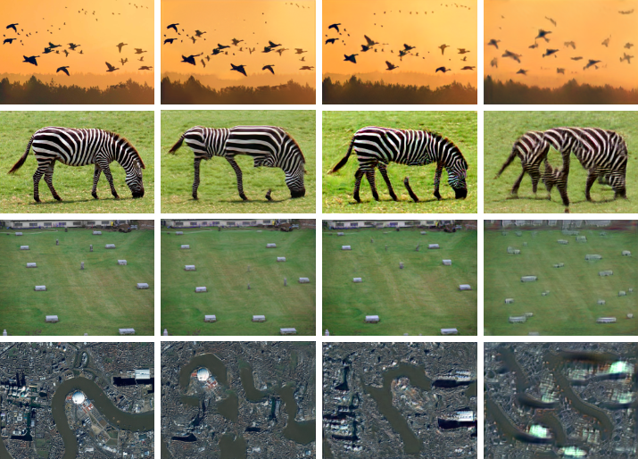
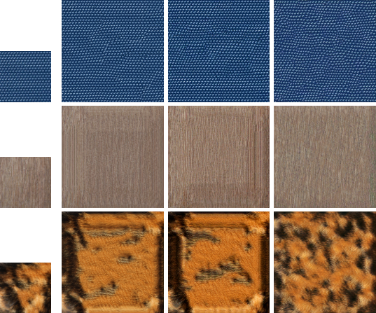

# SinGAN — single-image generative models, with and without a discriminator

**SinGAN** learns a generative model from one natural image and samples new images with the same
patch statistics. This repository contains a from-scratch PyTorch re-implementation of
SinGAN [1] and a discriminator-free variant trained with a Sliced Wasserstein distance (SWD) on
Inception-v3 features, both compared with the authors' implementation using Wasserstein and LPIPS metrics.



*From left to right: training image, official implementation [1], our re-implementation, our SWD
variant. From top to bottom: birds, zebra, grass, London (report, Figure 14).*

## Overview

- **Re-implementation.** Pyramid of fully convolutional generators and patch critics, trained
  coarse-to-fine with WGAN-GP and a reconstruction loss, written from the paper without the
  official code (only hyper-parameters missing from the paper were taken from the official repository).
- **Discriminator-free variant.** The critic at each scale is replaced by a fixed perceptual
  space: features from three Inception-v3 layers, matched to the training image with a
  differentiable SWD. The multi-scale scheme and the reconstruction loss are unchanged.
- **Evaluation.** Wasserstein distance between Inception feature clouds, LPIPS (VGG) and t-SNE
  visualisations, over 50 samples per training image.
- Team project for the IMA206 course (generative models, patch-based methods) at Télécom Paris,
  May–June 2025. Full report (in French): [`docs/report.pdf`](docs/report.pdf).

## Results

Mean distance between the training image and 50 generated samples (lower is better).
"Official" uses samples from the authors' code. Source: report, Tables 5–9.

| Image | Wasserstein, official | Wasserstein, ours | Wasserstein, ours SWD | LPIPS, official | LPIPS, ours | LPIPS, ours SWD |
|---|---|---|---|---|---|---|
| Grass | 26.47 | 26.77 | 28.27 | 0.323 | 0.332 | 0.482 |
| Birds | 26.05 | 24.53 | 28.07 | 0.373 | 0.296 | 0.412 |
| London | 33.91 | 33.97 | 33.10 | 0.640 | 0.646 | 0.647 |
| Zebra | 13.68 | 12.16 | 16.19 | 0.472 | 0.368 | 0.605 |

- Our re-implementation is on par with the official one on both metrics, with a lower LPIPS on
  zebra (0.368 vs 0.472).
- The SWD variant keeps Wasserstein distances of the same order but raises LPIPS: samples follow
  the texture statistics but lose global structure. With the same number of scales, training
  takes about 40% less time than the adversarial version, and 3–4 scales are enough instead of
  the 6–8 used by SinGAN (report, Section 5.6).
- The Wasserstein metric alone is misleading: zebra samples get the lowest distance although they
  are among the visually worst, which motivated LPIPS (report, Sections 3.4–3.5).

On textures, SWD samples are visually more varied and avoid the overfitted or overly regular
patterns of both adversarial versions (report, Section 6.4). Top to bottom: repeated pattern,
Gaussian texture, non-Gaussian texture; columns as above, samples larger than the input (report, Figure 15):



## Installation

```bash
python -m venv .venv
source .venv/bin/activate        # Windows: .venv\Scripts\activate
pip install -r requirements.txt
```

`sample.py` was tested with Python 3.12 and PyTorch 2.7 on CPU. Training is meant for a GPU.

## Quick start

Generate 8 samples from the pretrained zebra model (re-implementation):

```bash
python sample.py --model models/zebre/basic --image images/zebre.png --num-samples 8 --out-dir generated/zebre_basic
```

Same with the SWD variant:

```bash
python sample.py --model models/zebre/SWD --image images/zebre.png --num-samples 8 --out-dir generated/zebre_swd
```

| Argument | Meaning |
|---|---|
| `--model` | Model folder with `generators.pt`, `sigma_n.json`, `Description.txt` |
| `--image` | Training image of that model (sets the pyramid sizes) |
| `--num-samples` | Number of samples (default 8) |
| `--out-dir` | Output folder, files `1.png`, `2.png`, ... |
| `--seed` | Random seed (default 0) |

Pretrained models exist for `oiseau`, `zebre`, `herbe`, `london`, `motif`, `gaussian` and
`non_gaussian` (image `images/<name>.png`, or `images/london.jpg`), each in `basic/` and `SWD/`.

To train on a new image, set the image path in the first cells of
`notebooks/01_singan_training.ipynb` (SinGAN) or `notebooks/02_swd_training.ipynb` (SWD)
and run the notebook; its last cell writes the model folder.

## Repository structure

- `singan/models.py`: generator, patch critic, frozen multi-layer Inception-v3.
- `singan/swd.py`: differentiable Sliced Wasserstein distance between point clouds.
- `singan/sampling.py`: model loading, image pyramid, multi-scale generation.
- `singan/metrics.py`: Wasserstein and sliced Wasserstein on Inception features, Gaussian W2, LPIPS input.
- `sample.py`: command-line sampling from a saved model.
- `notebooks/01_singan_training.ipynb`: SinGAN training (WGAN-GP + reconstruction).
- `notebooks/02_swd_training.ipynb`: discriminator-free SWD training.
- `notebooks/03_sampling.ipynb`: samples and per-scale generations from a saved model.
- `notebooks/04_metrics.ipynb`: Wasserstein vs SWD timing, t-SNE, Wasserstein and LPIPS statistics.
- `notebooks/05_ot_sanity_check.ipynb`: SWD on pixel patches and Inception features, real vs random image.
- `notebooks/06_single_generator_experiment.ipynb`: exploratory test of one generator shared across scales.
- `models/<image>/{basic,SWD}/`: pretrained weights, noise levels and training hyper-parameters.
- `images/`: training images. `samples/`: 50 generated samples per image (8 for `non_gaussian`). `outputs/`: other samples.
- `docs/report.pdf`: project report (French).

## Method

**SinGAN.** Scale n produces `x_n = up(x_{n+1}) + G_n(z_n + up(x_{n+1}))`, from noise only at the
coarsest scale. Each `G_n` has 4 blocks (3x3 conv, batch norm, LeakyReLU) and a final 3x3 conv with
tanh, with 32 channels at the coarsest scales, doubled every 4 scales; the critic has the same body
and an 11x11 receptive field. Each scale minimises `L_WGAN-GP + alpha * ||x_n - G_n(z_rec)||^2`, and the noise amplitude
`sigma_n` is set from the reconstruction error of the coarser scale. Saved models use 8–9 scales,
`r = 4/3`, 2000 iterations per scale, 5 critic steps per 2 generator steps, Adam (lr 5e-4,
betas 0.5/0.999), alpha = 10, lambda_GP = 10.

**SWD variant.** The critic is removed. Generated and real images go through a frozen Inception-v3;
each of Mixed_5d (35x35x288), Mixed_6e (17x17x768) and Mixed_7c (8x8x2048) is turned into a point
cloud of `B*H*W` vectors, and the loss is `sum_k lambda_k * SWD(F_k(fake), F_k(real)) + alpha * L_rec`
with 128 random projections. The weights `lambda_k` ramp from the global to the fine layers within
each scale (from 0.4/0.7/1.0 to 1.0/0.7/0.4 for Mixed_5d/6e/7c). Saved models use 4–5 scales,
`r = 1.8` or `2`, 2000 iterations per scale, Adam (lr 1e-3), batches of 4 drawn from the image and
slightly rotated copies of it.

**Lessons from the re-implementation** (report, Section 4): the reconstruction loss is required for
convergence; the input coming from coarser scales must be regenerated at every iteration, otherwise
each generator sees a single example; size-preserving padding (instead of the paper's border
handling) slightly reduces diversity near the borders.

## References

1. T. R. Shaham, T. Dekel, T. Michaeli. *SinGAN: Learning a Generative Model from a Single Natural
   Image*. ICCV 2019. [arXiv:1905.01164](https://arxiv.org/abs/1905.01164)
2. R. Zhang et al. *The Unreasonable Effectiveness of Deep Features as a Perceptual Metric*. CVPR 2018.
   [arXiv:1801.03924](https://arxiv.org/abs/1801.03924)

## Team

Martin De Bats, Clément Gilli, Romain Planchon, Quentin Revillon (Télécom Paris).
Supervisors: Yann Gousseau, Arthur Leclaire.
Forked from [Loudwig/SinGan](https://github.com/Loudwig/SinGan).
